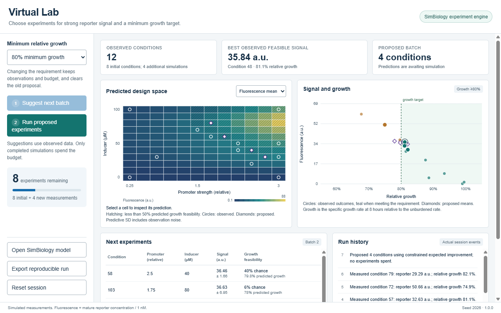

# Agentic Virtual Lab: Choose the Next Experiment

[](https://matlab.mathworks.com/open/github/v1?repo=ChezJe/iGEM&file=demos/agentic/app/demo.m)

Find a reporter design with strong fluorescence while preserving growth, using a limited budget of virtual experiments. MATLAB selects experiments from observed measurements, SimBiology runs the proposed conditions, and the results update the next recommendation. An existing Claude connection can operate the same functions as the app.

The challenge starts with **eight observations and twelve additional experiments**, grouped into batches of four. Raise the minimum growth requirement from **80% to 90%** and inspect how the next proposal changes. Completed measurements and the remaining budget are preserved.



All experiments are simulations of an illustrative reporter-expression model with growth burden. This example demonstrates a software workflow; it does not establish laboratory performance or claim an experiment-efficiency improvement.

## Start

Use **MATLAB R2026b**, **SimBiology**, and **Statistics and Machine Learning Toolbox**. The Online badge opens the launcher; select **Run**. Sign in with access to the required products.

From the repository root:

```matlab
launchIGEMDemo("agentic")
```

To control the app from MATLAB or Claude:

```matlab
addpath("demos/agentic")
lab = VirtualLabExplorer;
lab.getState()
```

The app runs without an AI service. For the live agent workflow, use an already configured Claude client connected to MATLAB and follow [prompts.md](prompts.md). The badge does not establish that connection.

## Explore the loop

1. Inspect the initial observations, predicted design space, and growth requirement.
2. Select **Suggest next batch**. Review the proposed designs, uncertainty, and predicted feasibility. Suggesting experiments does not consume the budget.
3. Select **Run proposed experiments**. SimBiology evaluates each condition and records fluorescence and growth from the same model.
4. Change the minimum growth requirement to **90%**. The previous proposal becomes invalid; request a new batch based on the observations already collected.
5. Continue until the twelve-experiment budget is exhausted, or export the current run.
6. Select **Open SimBiology model** to inspect the mechanistic experiment engine.

The constraint is a target for measured outcomes, not a guarantee about an unmeasured design. Predicted feasibility and observed constraint satisfaction are shown separately. Only completed experiments consume the budget. Completed results survive cancellation or a failed later experiment.

## Ten-minute presentation

| Time | Action | Takeaway |
|---|---|---|
| 0:00–1:00 | Introduce the objective and budget; inspect the initial data | A useful experiment must balance signal and growth. |
| 1:00–2:30 | Request a batch and inspect its predictions | Uncertainty influences which experiments are useful. |
| 2:30–4:00 | Run the conditions through SimBiology | The same model produces both responses. |
| 4:00–5:30 | Raise the growth requirement from 80% to 90% | New requirements change the decision while observations remain available. |
| 5:30–8:00 | Use Claude to inspect, propose, execute, and summarize through the public methods | An agent can orchestrate a bounded, inspectable scientific workflow. |
| 8:00–10:00 | Open the model, export the record, and show the Live Script | The result includes executable methods and a reproducible experiment record. |

## MATLAB interface

| Method | Purpose |
|---|---|
| `lab.getState()` | Inspect observations, proposal, budget, and event history |
| `lab.proposeBatch()` | Recommend distinct, untested conditions |
| `lab.runBatch()` | Execute proposed conditions and update the app |
| `lab.setGrowthThreshold(0.9)` | Change the minimum relative-growth requirement |
| `lab.resetSession()` | Restore the initial experiment state |
| `lab.openModel()` | Open the model in SimBiology Model Builder |
| `lab.exportRun()` | Save a reproducible run record |

The `virtuallab` package provides corresponding functions for scripts. Its experiment selector uses only recorded observations. The simulator is called when experiments execute, rather than to reveal unseen candidate results to the selector.

## Files

| File or directory | Purpose |
|---|---|
| `app/demo.m` | Online and desktop entry point |
| `VirtualLabExplorer.m` | MATLAB app controller and methods available to Claude |
| `web/virtual-lab.html` | Local HTML/CSS/JavaScript/SVG interface |
| `+virtuallab/` | Session state, SimBiology simulation, Gaussian-process predictions, experiment selection, and export |
| [model/README.md](model/README.md) | SimBiology model, equations, units, and assumptions |
| `walkthrough/virtualLabWorkflow.m` | Reproducible scripted experiment loop |
| `prompts.md` | Claude instructions for operating the app |
| `claude-session/` | Session starting instructions and scripted recovery |
| `introduction/` | The smaller plate-reader growth-analysis example |

## Interpretation and reproducibility

- Promoter strength and inducer level are the design factors. Fluorescence is mature-reporter concentration divided by 1 nM; relative growth is the endpoint specific growth rate divided by the unburdened reference rate at eight hours. See the model description for equations and assumptions.
- The model is illustrative and has not been calibrated against experimental data. The earlier plate-reader example is independent introductory data; it is not joined to this model's observations.
- Gaussian-process predictions and constrained expected improvement guide selection. Uncertainty is conditional on the surrogate assumptions and the small observation set.
- The run record includes selections, outcomes, seed, model version, budget, and event history. The Live Script shows the same workflow without an agent.
- Export into a new run folder. Existing run files are protected from replacement. Use `virtuallab.replay(folder)` to re-simulate the recorded conditions and inspect differences from the saved measurements.
- A tighter constraint may leave no observed feasible design. The app reports that condition instead of presenting an infeasible result as a solution.
- The planner is MATLAB code. Claude participates only when an actual connected client calls the methods. Scripted recovery does not represent a recorded or live Claude session.
- A claim of needing fewer experiments would require an equal-budget comparison across repeated runs. No such performance claim is made here.

[Back to the demo portfolio](../../README.md)
