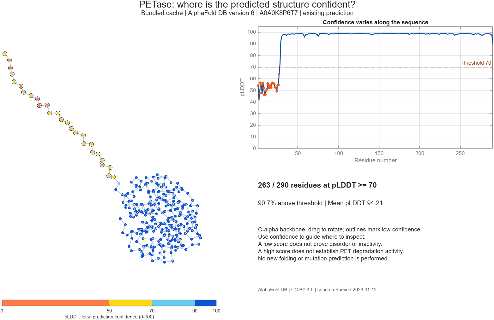

# PETase: inspect AlphaFold prediction confidence

Explore a PETase protein prediction in **Biopipeline Designer**. Five connected blocks retrieve or read a prediction, extract one confidence observation per residue, and display a rotatable structure and confidence profile. Designed for a seven-minute iGEM walkthrough.

The badge opens the launcher. Select **Run** to start. MATLAB Online requires a MathWorks Account and access to MATLAB and Bioinformatics Toolbox.

## Run

Requires **MATLAB R2026b** and **Bioinformatics Toolbox**. No additional programs, containers, or API keys are needed. Cached mode works offline.

1. Open [`app/demo.m`](app/demo.m) and click **Run**. The completed figure and saved pipeline open.
2. In Biopipeline Designer, click **Run** to execute all five blocks.
3. Select **ConfidenceThreshold**. In its input values, change **Threshold** from `70` to `50`, then run again.
4. To show retrieval, select **MetadataAndCache**, change **Mode** from `"cached"` to `"live"`, and run. Only the public AlphaFold DB service is contacted.

From the demo folder, the equivalent MATLAB command is `launchPetaseDemo`. For a programmatic pipeline, call `createPetasePipeline("cached",70)`. Open [`walkthrough/petaseConfidence.m`](walkthrough/petaseConfidence.m) to inspect and adapt the analysis in the Live Editor.

## Seven-minute walkthrough

| Time | Presenter action | Point to make |
|---|---|---|
| 0:00–0:30 | Introduce PETase and the protein accession | Which parts of a predicted structure deserve confidence? |
| 0:30–1:30 | Show the finished figure; rotate the backbone | Local confidence varies along the sequence. |
| 1:30–5:00 | Trace MetadataAndCache → ReadPrediction → ResidueConfidence → ConfidenceThreshold → VisualizePETase | Reusable blocks make the data flow visible. pLDDT is extracted once per residue, not once per atom. |
| 5:00–6:00 | Lower the threshold from 70 to 50 and rerun | The criterion changes; the coordinates remain fixed. |
| 6:00–7:00 | State the limitation and show the companion Live Script | Confidence helps inspection; enzyme activity still needs evidence. |

In the bundled model, **263 of 290 residues** have pLDDT ≥70 and **283** have pLDDT ≥50. Residues 1–27 are below 70. Lower confidence alone does not establish disorder, inactivity, or a beneficial mutation. A high score does not prove PET degradation performance. This demo retrieves **existing predictions**; it does not run AlphaFold or predict new sequences. The model is a monomer and the demo does not analyze PAE or protein complexes.

## Data and recovery

- **Accession:** A0A0K8P6T7; **model:** AF-A0A0K8P6T7-F1, database version 6; **length:** 290 residues.
- **Protein:** poly(ethylene terephthalate) hydrolase, PETase. The retrieved metadata names the organism *Piscinibacter sakaiensis*.
- **Source:** [AlphaFold DB metadata](https://alphafold.ebi.ac.uk/api/prediction/A0A0K8P6T7) and the versioned PDB URL returned in that response.
- **Attribution:** AlphaFold Protein Structure Database and Google DeepMind. [Jumper et al., Nature (2021)](https://doi.org/10.1038/s41586-021-03819-2). Data licensed under [CC BY 4.0](https://creativecommons.org/licenses/by/4.0/). Original PDB attribution is retained.
- [`data/cache/provenance.json`](data/cache/provenance.json) records URLs, model version, retrieval timestamp, and SHA-256 hashes. The bundled prediction and metadata are unmodified.

Cached mode works offline. Live mode uses one metadata request and one structure request, each with an eight-second request timeout and no retries. If either request or payload validation fails, the bundled metadata and structure are used together. The figure and summary say **LIVE REQUEST FAILED | bundled cache, version 6**, and the reason appears in MATLAB output. Live retrieval preserves the frozen bundled cache.

To recover during a presentation, return **Mode** to `"cached"`, **Threshold** to `70`, and run again. To restore the original pipeline after other edits, reopen [`petaseConfidence.plprj`](petaseConfidence.plprj). Re-running `launchPetaseDemo` also restores the completed baseline figure.

## Files

| File or folder | Purpose |
|---|---|
| [`app/demo.m`](app/demo.m) | MATLAB Online entry and app launcher |
| [`petaseConfidence.plprj`](petaseConfidence.plprj) | Saved five-block native pipeline |
| [`launchPetaseDemo.m`](launchPetaseDemo.m) | Reproducible result and app launch |
| [`createPetasePipeline.m`](createPetasePipeline.m) | Build the pipeline from MATLAB code |
| [`walkthrough/petaseConfidence.m`](walkthrough/petaseConfidence.m) | Explanatory plain-text Live Script using the same functions |
| `functions/` | Retrieval, validation, residue extraction, summaries, and plots |
| `data/cache/` | Versioned PDB, exact metadata response, and provenance |
| [`assets/petase-confidence.png`](assets/petase-confidence.png) | Preview of the predicted structure and confidence profile |
| [`assets/pipeline-app.png`](assets/pipeline-app.png) | Preview of the five-block workflow in Biopipeline Designer |

[Back to all iGEM demos](../../README.md)
