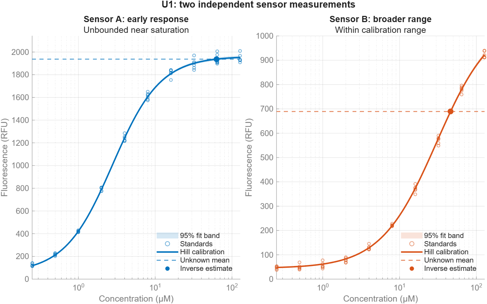

# Calibrate a fluorescent biosensor

Compare two synthetic fluorescent sensors measuring the same unknown sample. A MATLAB app shows why a bright, nearly saturated response can give a less useful concentration estimate than a response within the calibration range. The accompanying Live Script exposes the same fitting and inference functions.

The badge opens the launcher. Press **Run** to open the app. MATLAB Online requires a MathWorks Account and imports this repository into your MATLAB Drive.

## File Manifest

| File or directory | Purpose |
|---|---|
| [app/demo.m](app/demo.m) | Launch the completed app. |
| [BiosensorExplorer.m](BiosensorExplorer.m) | App launch, sample selections, and CSV export. |
| [web/biosensor.html](web/biosensor.html) | Self-contained HTML, CSS, JavaScript, and SVG interface. |
| [walkthrough/biosensorCalibration.m](walkthrough/biosensorCalibration.m) | Plain-text Live Script: standards, fitting, inverse estimates, and uncertainty. |
| [walkthrough/setupBiosensor.m](walkthrough/setupBiosensor.m) | Set the demo path from the walkthrough folder. |
| [+biosensor/generateData.m](+biosensor/generateData.m) | Generate seeded synthetic observations and bootstrap fits. |
| [+biosensor/fitCalibration.m](+biosensor/fitCalibration.m) | Weighted positive-parameter Hill fitting and stratified resampling. |
| [+biosensor/hillResponse.m](+biosensor/hillResponse.m) | Evaluate the Hill response. |
| [+biosensor/inferConcentration.m](+biosensor/inferConcentration.m) | Shared inverse estimates, intervals, and range statuses. |
| [+biosensor/makeState.m](+biosensor/makeState.m) | Convert MATLAB results into display data without changing the analysis. |
| [+biosensor/plotCalibration.m](+biosensor/plotCalibration.m) | Plot the same calibration and unknown measurements in MATLAB. |
| [+biosensor/loadData.m](+biosensor/loadData.m) | Load and validate the prepared data bundle. |
| `data/biosensorData.mat` | Measurement tables, fitted curves, 400 bootstrap parameter sets per sensor, and synthetic truth. |
| `data/calibration.csv` | Six observations at each of 11 concentrations for each sensor. |
| `data/unknown_samples.csv` | Six independent measurements for each of three samples and each sensor. |
| `data/synthetic_truth.csv` | Known synthetic concentrations for comparing with the inferred results. |
| `assets/calibration-preview.png` | MATLAB-generated view of U1 and the two fitted response curves. |

## Presentation Flow

1. **Question — 0:30.** A sensor fluoresces strongly. Does that mean it can quantify the sample precisely?
2. **Completed result — 1:00.** Run the app with **U1** selected. Compare the two result cards, then emphasize Sensor B. Each sensor has its own measurement of the same sample.
3. **Walkthrough — 3:30.** Open `walkthrough/biosensorCalibration.m` in the Live Editor. Inspect replicated standards, fit the positive Hill model, and invert the unknown measurements. The app and Live Script call the same functions.
4. **Interaction — 1:00.** Select **U2** and **U3**, or hide the fit bands. Inspect the interval and status as well as the curve. Reset returns to U1, Sensor A, with the bands visible.
5. **Takeaway — 1:00.** Choose a sensor for its useful concentration range. Export the displayed results, including the limitation statuses, and show the README link.

## Setup Instructions

1. Use MATLAB R2026b. No additional toolboxes are required.
2. Open `app/demo.m` and press **Run**. The launcher adds the demo folder to the path and loads the bundled data.
3. For the walkthrough, open `walkthrough/biosensorCalibration.m`. Run it from its folder, or allow MATLAB to change to that folder when prompted.
4. To regenerate the complete dataset, add the demo folder to the path and run `biosensor.generateData`. This rebuilds the measurements, CSV files, and bootstrap fits using fixed local random streams. Regeneration is preparation work; it is not required when opening the app.

The app's **Export results as CSV** action uses a MATLAB save dialog. It exports both sensors for the displayed sample, along with the emphasized sensor, units in column names, bootstrap count, and bundle version. Cancelling the dialog leaves the results unchanged. In MATLAB Online, save to MATLAB Drive and download the CSV through its file browser if needed.

To adapt the example, inspect the sensor parameters, standards, and noise assumptions in `biosensor.generateData`, regenerate the dataset, and rerun the Live Script. The shared fitting and inference functions keep the app and walkthrough consistent.

## Data and Methods

All observations were generated for this demonstration; they are not experimental measurements or predictions of a named biological sensor. Concentration is in µM and fluorescence is in RFU. The two sensors have different response curves and independent noise. Each sensor's replicate measurements of an unknown are analyzed separately.

The Hill model is `F(c) = B + A*c^h/(K^h + c^h)`, with positive baseline, amplitude, EC50, and Hill coefficient. Weighted least squares uses within-standard replicate variation with a 5 RFU noise floor. Four hundred seeded bootstrap resamples preserve the concentration groups. Pointwise curve bands describe calibration-fit uncertainty. Inverse concentration intervals also resample the unknown replicates.

Inverse draws below a fitted baseline are lower-censored at zero; draws reaching or exceeding the fitted plateau remain infinite. No invalid upper-tail draws are discarded to manufacture a finite interval. The reported interval uses the 2.5th and 97.5th empirical percentiles. An exported point estimate may exist outside the usable range; the `Quantifiable` and `Status` columns qualify its interpretation.

A response above 95% of the fitted amplitude receives a **Near saturation** caution. This is an explicit demonstration threshold, not a validated assay limit. EC50 is the half-amplitude concentration, not a detection limit. These intervals omit other experimental error sources, such as unknown matrix effects or systematic calibration drift.

## Presentation Notes

- Start with the completed app. The controls and SVG plots are a view of MATLAB results; fitting and inverse estimation remain in MATLAB.
- Use the supplied unknowns for the short presentation. U1 highlights response range, U2 provides an in-range example, and U3 exposes weak-signal limits.
- The data generator deliberately includes additive and proportional noise. The same sample does not produce the same RFU value in both sensors.
- The app loads prepared bootstrap fits so selections remain quick. The Live Script refits the central curves and explains how the prepared uncertainty was calculated.
- The Live Script also provides the analysis and standard MATLAB figures for a code-focused presentation.

[Back to the demo collection](../../README.md)
