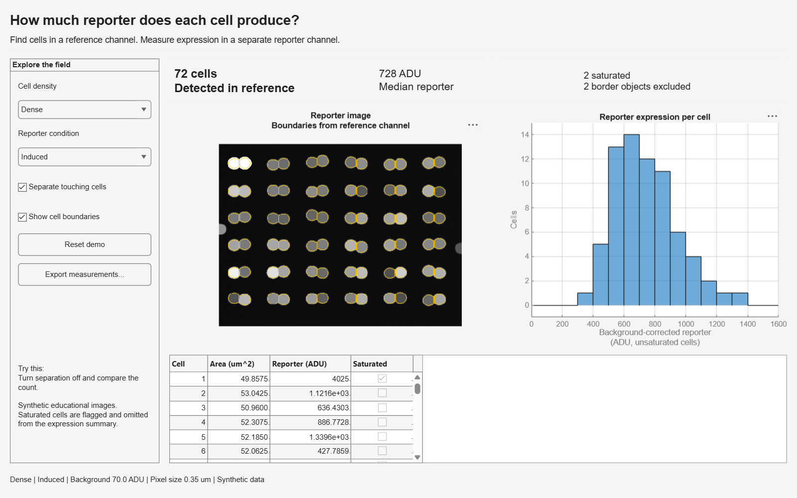

# Quantify reporter expression with Microscopy Explorer

Find cells in a reference channel and measure fluorescence in a separate reporter channel. This seven-minute demo for iGEM teams shows why counting cells and quantifying expression are different tasks.

[](https://matlab.mathworks.com/open/github/v1?repo=ChezJe/iGEM&file=demos/microscopy/great-demo/demo.m)

The badge opens the launcher. Select **Run** to open the app. MATLAB Online requires a MathWorks Account and access to MATLAB and Image Processing Toolbox.



## Start the demo

Use **MATLAB R2026b or later** with **Image Processing Toolbox**. The app uses the plain-text App Designer format; keep `MicroscopyExplorer.m` and `MicroscopyExplorer.xml` together. No additional software, internet data, or API keys are needed.

From the repository root:

```matlab
run("demos/microscopy/great-demo/demo.m")
```

The app starts with a dense, induced field: **72 detected cells**, including **two saturated cells** that are excluded from expression summaries. Two border objects are excluded. Turning **Separate touching cells** off produces 36 merged objects.

To inspect the code in the Live Editor, set the current folder to `demos/microscopy/walkthrough`, open `microscopyWalkthrough.m`, and select **Run**. It calls exactly the same segmentation and measurement function as the app.

## Presentation flow

| Time | Action | Point to make |
|---|---|---|
| 0:00–0:30 | Ask whether a brighter image contains more cells or brighter cells. | Define the measurement question. |
| 0:30–1:30 | Show the completed dense-field app. | Inspect individual cells and the reporter distribution. |
| 1:30–3:00 | In the walkthrough, compare reference and reporter channels. | Detect cells independently of reporter expression. |
| 3:00–4:30 | Toggle touching-cell separation. | Connected objects can undercount individual cells. |
| 4:30–5:30 | Switch between basal and induced conditions. | Expression changes while the reference-derived cell count stays fixed. |
| 5:30–6:00 | Point out saturated cells and border exclusions. | Quality flags remain visible in the measurements. |
| 6:00–7:00 | Export measurements, reset, and show the Live Script. | Share both results and analysis settings. |

The image displays the reporter channel on a fixed 0–1500 ADU display scale. Yellow outlines come from segmentation of the reference channel. Bright pixels above the display range appear white; **camera saturation is a separate 4095 ADU threshold**. The histogram and median exclude cells containing saturated camera pixels. The table retains them with a flag.

## Data and analysis

All images are synthetic, generated with seed 2026. They represent round cell cross-sections in sparse fields and touching pairs in dense fields; they are not experimental observations or a validated biological model. Each field has 512×384 pixels at an assumed 0.35 µm/pixel, with 12-bit camera counts stored as `uint16`. Fields include noise, mild background gradients, small debris, border cells, and heterogeneous reporter signals. Basal and induced conditions share the same reference image within each density.

The analysis smooths the reference channel, applies an Otsu threshold, fills holes, removes objects smaller than 80 pixels, excludes border objects, and optionally applies distance-transform watershed. It then estimates reporter background outside a dilated foreground mask and measures the background-corrected mean for each detected cell. Bundled ground-truth masks let you compare the detected cells with the generated scene; segmentation does not use those masks.

**Export measurements** writes the current per-cell table as CSV, including centroids, area in pixels and µm², corrected reporter intensity in ADU, saturated-pixel fraction, saturation flag, field, condition, and analysis settings. Cancelling the file picker leaves the analysis unchanged. `getMeasurements` and `exportMeasurements` are also public app methods for inspecting or saving the current results programmatically.

Real microscopy data will require representative manual annotations, acquisition-specific background and segmentation choices, and independent biological replicates. These image fields are designed to explain the workflow, not estimate population-level biological significance.

## Files and reproducibility

| Path | Purpose |
|---|---|
| `great-demo/demo.m` | Launcher used by the Online badge. |
| `great-demo/MicroscopyExplorer.m` and `.xml` | Editable App Designer application. |
| `walkthrough/microscopyWalkthrough.m` | Plain-text Live Script explaining the analysis. |
| `data/microscopyFields.mat` | Four bundled image fields, ground truth, and acquisition metadata. |
| `functions/generateMicroscopyData.m` | Seeded synthetic image generator. |
| `functions/loadMicroscopyData.m` | Portable bundled-data loader. |
| `functions/analyzeMicroscopyField.m` | Shared segmentation and reporter measurements. |
| `functions/microscopyExportTable.m` | Combine per-cell results with their settings. |
| `assets/microscopy-preview.png` | Preview of the app's cell outlines and reporter measurements. |

Regenerate the bundled data from the repository root:

```matlab
addpath("demos/microscopy/functions")
generateMicroscopyData("demos/microscopy/data/microscopyFields.mat");
```

To adapt the example, inspect the image-generation assumptions in `generateMicroscopyData` and the segmentation settings in `analyzeMicroscopyField`. Use the Live Script to compare the resulting outlines and measurements before applying the workflow to new images.

If a live demonstration is interrupted, reopen the launcher or select **Reset demo**. See the [portfolio README](../../README.md) for the other four demos.
